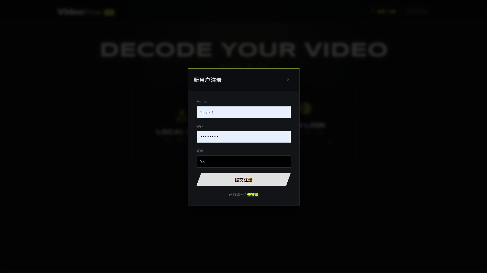
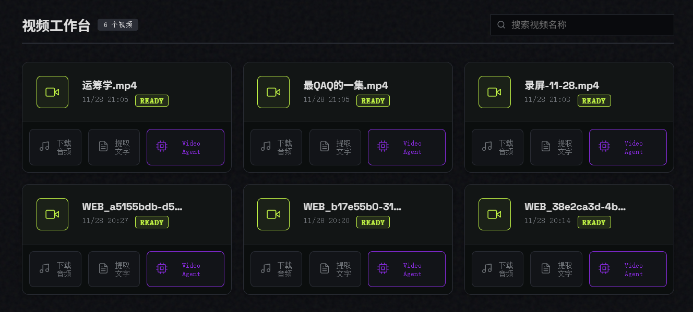
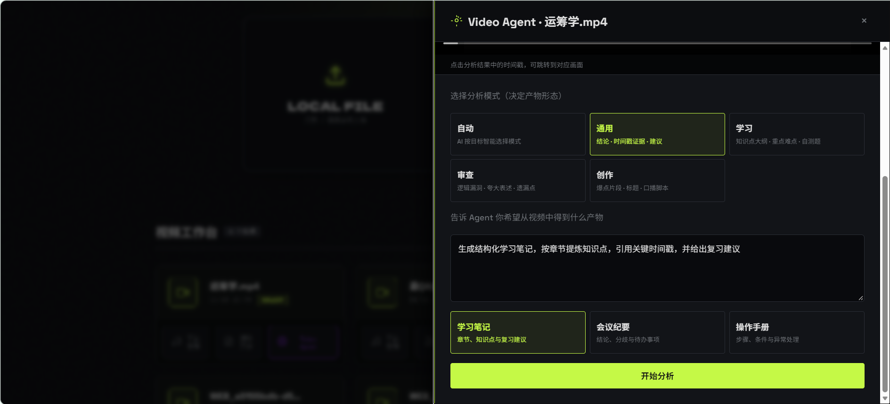
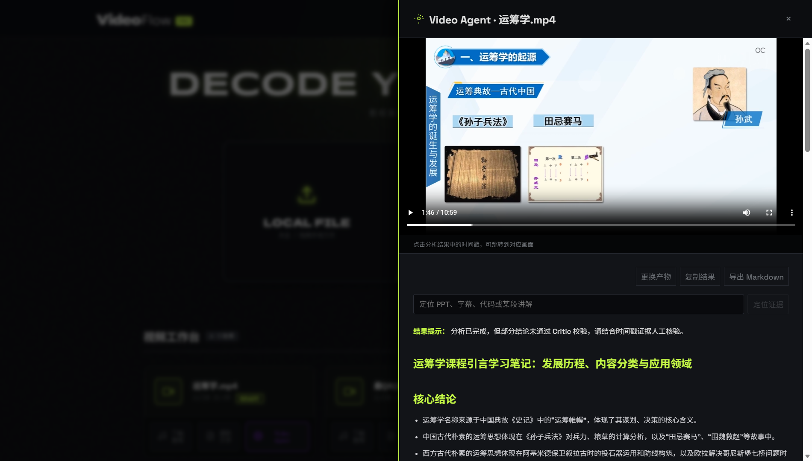
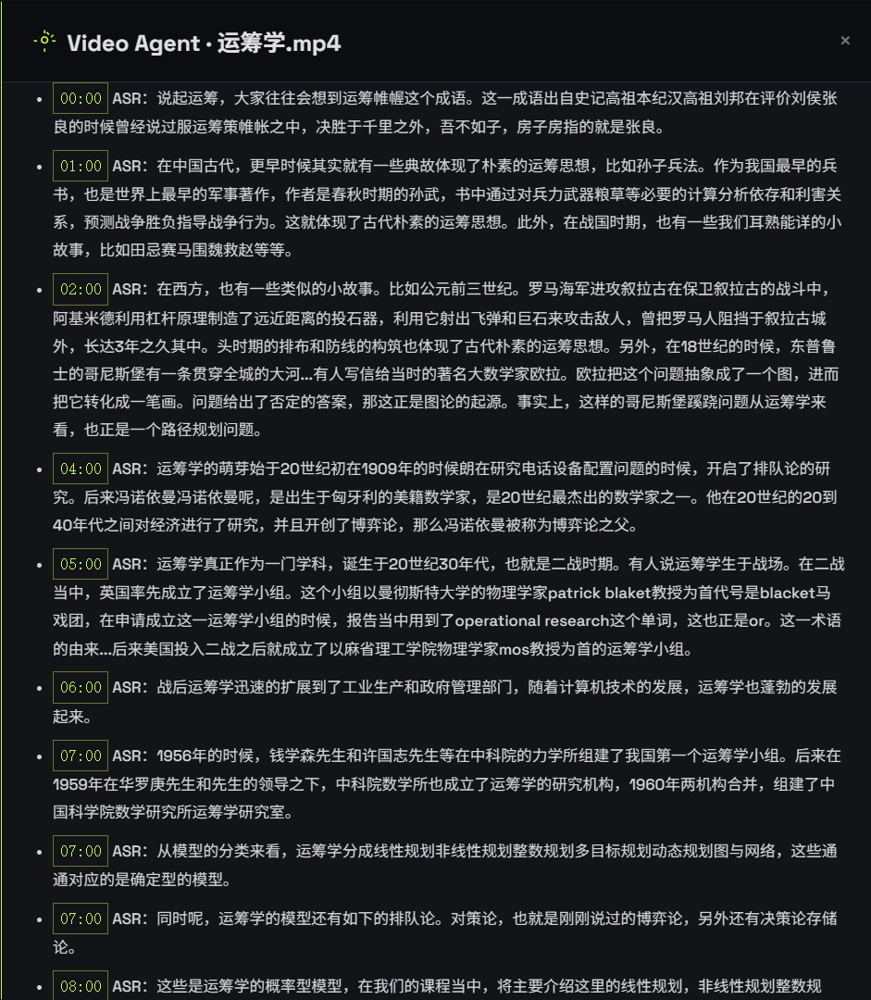
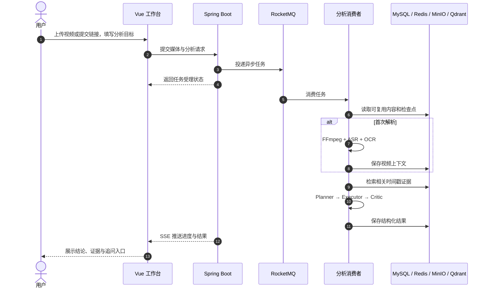

<div align="center">

<h1>VideoFlow</h1>

<p>
  
  
  
  
  
  
  
</p>

<p>面向长视频的智能分析工作台</p>
<p>把视频中的语音和画面内容转化为可检索、可追溯、可继续追问的结构化知识。</p>

</div>

## 项目预览
**登录与注册**

**视频工作台**

**分析目标与模式选择**

**分析结果与时间戳证据**


用户完成登录后，可以上传视频并在工作台管理解析任务；选择视频并输入分析目标后，可以手动选择分析模式，也可以交给 Agent 自动判断。工作台会展示结构化结论、时间戳证据、执行计划、阶段轨迹与质量评估，并支持基于同一视频继续追问；追问历史会通过 Redis 保存，模型可结合多轮对话上下文作答。
## 核心功能

长视频处理天然是**长耗时、高资源消耗、外部调用成本敏感**的场景。VideoFlow 的设计都围绕这一背景展开，可以概括为四层能力。

### 🎬 可靠的视频任务链路

> 把大文件上传与耗时的视频解析从请求主链路中剥离，提交即返回，不阻塞、不重复烧钱。

- **分片上传 + 断点续传** — 前端按 5 MB 分片，Redis 记录已完成分片，MinIO 保存合并后的视频，弱网中断后可从断点续传。
- **异步削峰** — RocketMQ 将视频解析移出请求线程，提交后立即返回任务 ID；任务按「媒体记录 + 分析目标 + 模式」隔离，同内容结果通过共享锁复用，避免重复消费和重复计算。
- **成本护栏** — 用户级与全局令牌桶限制 AI 请求速率；ASR 与模型调用采用有限次数的指数退避重试，兜底第三方网络抖动。

### 🧩 时序多模态 VideoContext

> 把语音、画面文字与时间戳融合成一份可检索、可校验的统一上下文。

- **双分支抽取** — FFmpeg 将音频按 60 秒切片，同时通过场景变化检测抽取关键帧，并以 30 秒保底采样避免遗漏静态板书。
- **并行与容错** — ASR 与 OCR 使用独立有界线程池并行执行；相邻画面通过感知哈希去重，单路失败时仍保留另一条有效信息。
- **统一结构** — 语音区间、OCR 文本、关键帧与时间戳被合并为统一的 `VideoSegment`，后续检索与校验不再依赖底层模型格式。

```text
[02:00 - 03:00]
ASR      接下来讲解二叉树的前序遍历
OCR      前序遍历：根节点、左子树、右子树
Evidence frame_000125.jpg
```

### 🔁 有证据约束的 AgentLoop

> 每条结论都必须绑定可在原始视频中核验的时间戳证据，拒绝模型自由发挥。

- **角色分工** — Planner 将用户目标拆成可执行任务，Executor 生成固定结构的结论、证据与建议。
- **闭环校验** — Critic 检查目标覆盖、结构完整性与时间戳证据；不通过时依据缺失内容和时间范围定向重新检索。
- **自动模式路由** — 根据用户目标自动选择通用、学习、审查或创作模式；路由不可用时回退通用模式，不阻断分析任务。
- **四类结构化产物** — 通用模式生成结论与建议，学习模式生成大纲、自测题与易错点，审查模式定位逻辑漏洞与存疑结论，创作模式提取爆点、标题与口播脚本。
- **成本可控** — AgentLoop 最多执行两轮，既允许定向修正，也通过轮次上限约束延迟与 Token 成本。

### 🔍 长视频检索与断点恢复

> 面向数小时长视频的分段检索，以及分阶段可恢复的任务状态机。

- **混合检索** — 每 5 分钟生成片段摘要、关键词与 Embedding，通过关键词匹配与 Qdrant 语义召回选出 TopK 原始证据。
- **优雅降级** — Qdrant 或 Embedding 服务不可用时，退化到本地关键词与已有向量排序，不阻断主分析链路。
- **断点恢复** — Checkpoint 以 MySQL 为恢复真源、Redis 为热缓存，持久化 `VideoContext`、分块、计划、Critic 状态与最终结果。
- **状态可观测** — 前端通过 SSE 接收任务阶段；失败消息写入独立失败主题与失败任务表，可由管理接口重新投递。

## 系统流程



## 技术栈

| 层次 | 技术 | 主要用途 |
| --- | --- | --- |
| 前端 | Vue 3、Vite、SSE | 视频工作台、实时进度与结果展示 |
| 后端 | Java 21、Spring Boot 3.5.9、MyBatis-Plus、Flyway | API、鉴权、任务编排与数据迁移 |
| 异步与缓存 | RocketMQ、Redis、Redisson | 异步任务、状态缓存与并发控制 |
| 数据与存储 | MySQL、MinIO、Qdrant | 业务数据、视频文件与证据检索 |
| 视频与模型 | FFmpeg、Tesseract、`yt-dlp`、SiliconFlow | 媒体处理、ASR/OCR 与模型推理 |

## 启动项目

Windows 请在 IDEA 的 **Git Bash** 终端执行（Shell path：`"E:\Git\bin\bash.exe" --login -i`）。先启动 Docker Desktop；以下命令均从项目根目录执行，前后端分别使用独立终端。

需要 JDK 21+、Node.js 22+；首次使用先将 `.env.example` 复制为 `.env` 并填写密码和模型密钥，已有 `.env` 请保留。视频分析还需要 FFmpeg、Tesseract 和 `yt-dlp`。

### 1. 启动中间件

```bash
bash scripts/dev-up.sh
```

启动 MySQL、Redis、MinIO、Qdrant 和 RocketMQ。看到 `Middleware ready` 后继续。

### 2. 启动前端

```bash
cd client
npm ci && npm run dev -- --port 5173 --strictPort
```

打开 [http://127.0.0.1:5173](http://127.0.0.1:5173)。已安装依赖时，之后只需在 `client` 目录运行 `npm run dev -- --port 5173 --strictPort`。

### 3. 启动后端

```bash
bash scripts/start-backend.sh
```

脚本自动加载 `.env`。看到 `Started ServerApplication` 表示启动成功。后端端口取 `.env` 的 `SERVER_PORT`，前端 `VITE_DEV_PROXY_TARGET` 必须使用同一端口和 `127.0.0.1`。

需要断点调试时，直接在 IDEA 选择 **VideoFlow Backend (IDEA)** 并点击 Debug，替代上面的后端命令；不要重复启动。

### 4. 全部启动

```bash
bash scripts/dev-up.sh --full-stack
```

一次启动中间件、前端和后端，全部运行在 Docker 中，访问 [http://127.0.0.1:5173](http://127.0.0.1:5173)。使用此方式前，先停止本机前后端，并执行 `docker compose --env-file .env -f compose.yaml -f compose.dev.yaml stop` 停止开发中间件。

本机前后端按 `Ctrl+C` 停止（IDEA Debug 使用 Stop）；Docker 服务用 `docker compose stop` 停止，数据保留。详细配置见 [本地部署说明](docs/LOCAL_DEPLOYMENT.md)。

## 主要配置

完整配置见 [`.env.example`](.env.example)。常用项：

| 配置项 | 作用 |
| --- | --- |
| `SERVER_PORT`、`VITE_DEV_PROXY_TARGET` | 后端端口和前端代理目标 |
| `CORS_ALLOWED_ORIGINS` | 允许访问后端的前端地址；更换前端端口时同步调整 |
| `SILICONFLOW_API_KEY`、`LLM_MODEL` | 模型服务凭据与模型 |
| `LLM_TIMEOUT_SECONDS` | 单次模型调用超时，默认 300 秒 |
| `AGENT_MAX_DURATION_MS` | 整次 Agent 分析时长上限，默认 20 分钟 |
| `YTDLP_COOKIES`、`YTDLP_COOKIES_FROM_BROWSER` | 需要登录态的视频站点 Cookie 配置 |

默认 Compose 使用 MySQL `3307`、Redis `6379`、MinIO `9000/9001`、Qdrant `6333` 和 RocketMQ NameServer `9876`。端口冲突时，要同时修改 Compose 映射与 `.env` 中的连接地址。

## 测试与扩展

在项目根目录的 Bash 终端运行：

```bash
(cd server && bash ./mvnw test)
(cd client && npm test && npm run build)
(cd extension && node --test)
bash scripts/tests/load-env.test.sh
```

推送和拉取请求会触发 [GitHub Actions CI](.github/workflows/ci.yml)。浏览器扩展的安装步骤见 [扩展说明](extension/README.md)。

## 常见问题

- **注册提示 `Invalid CORS request`**：把当前前端地址加入 `CORS_ALLOWED_ORIGINS`，然后重启后端。
- **分析提示任务预算耗尽**：检查 `AGENT_MAX_DURATION_MS`；它限制整次分析，`LLM_TIMEOUT_SECONDS` 限制单次模型调用。
- **在线视频链接下载失败**：确认 `yt-dlp` 可用；部分站点需要配置 Cookie。

## 项目结构

```text
VideoFlow-AI/
├── client/                # Vue 工作台
├── server/                # Spring Boot API 与 Video Agent
├── extension/             # 浏览器侧边栏扩展
├── scripts/               # 本地启动脚本
├── docs/                  # 补充文档
├── compose.yaml           # 完整容器部署
├── compose.dev.yaml       # IDEA 本地调试覆盖配置
└── .env.example           # 环境变量模板
```
